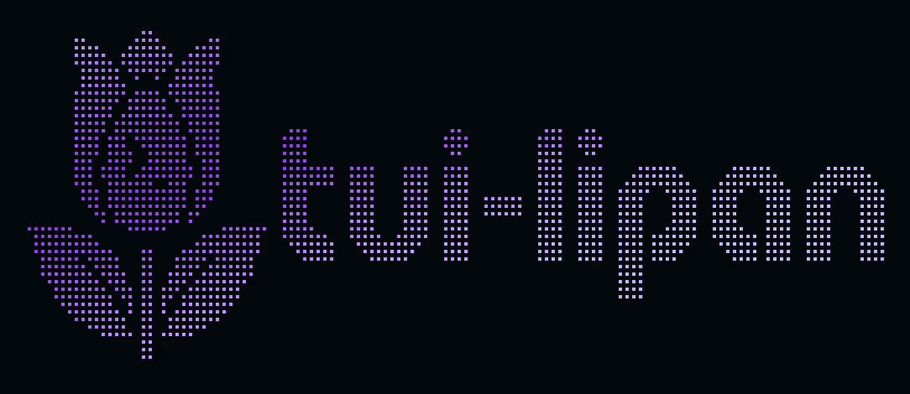
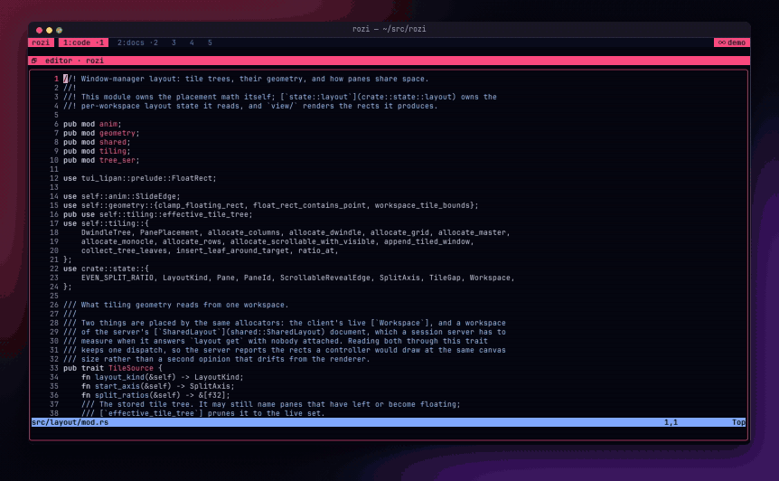
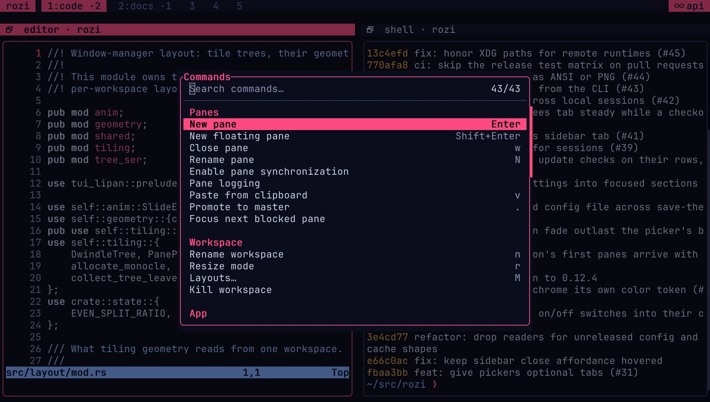
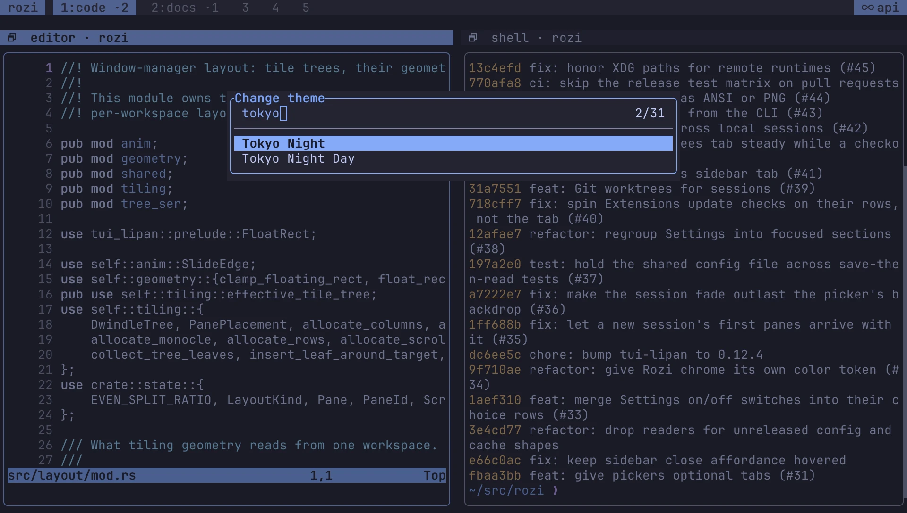
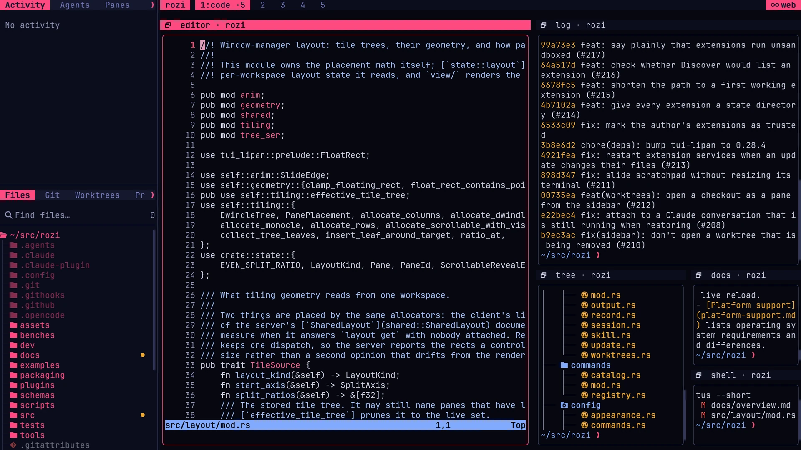

<div align="center">



# tui-lipan

**Opinionated, component-based TUI framework for Rust.**

Write components and messages like in Elm or React. tui-lipan handles layout,
focus, mouse, overlays, animation, and rendering, so a polished terminal app
does not have to be a fight.

[](https://crates.io/crates/tui-lipan)
[](https://docs.rs/tui-lipan)
[](https://context7.com/websites/tui-lipan_dev)
[](https://github.com/tui-lipan/tui-lipan/actions/workflows/ci.yml)
[](#license)
[](CONTRIBUTING.md)
[](https://github.com/sponsors/Razuer)

[Website](https://tui-lipan.dev) ·
[Documentation](https://docs.tui-lipan.dev) ·
[Examples](examples/) ·
[Releases](https://github.com/tui-lipan/tui-lipan/releases)

</div>

<p align="center">
  
  <br />
  <sub>Every clip is a runnable example in <a href="examples/"><code>examples/</code></a>,
  recorded headlessly by tui-lipan itself (<a href="docs/testing.md#terminal-recordings"><code>TUI_LIPAN_RECORD</code></a>).</sub>
</p>

---

## What you get

- **Components** with typed `Message`, `Properties`, and `State`; `view()` returns
  a declarative `Element` tree and the runtime reconciles it.
- **Flexbox-inspired layout**: stacks, grids, frames with titled borders, splitters,
  scroll views. lazygit-style panel chrome out of the box.
- **Mouse and focus everywhere**: precise hit-testing, hover, drag, focus scopes,
  tab order, and key bubbling from the focused widget up to the root.
- **Overlays**: modals, popovers, context menus, toasts, and command palettes with
  focus capture and dismissal policies.
- **Async without threads in your UI**: background work runs as a `Command` and
  comes back as a typed message.
- **Over 70 widgets**: forms, tables, trees, file tree, log view, diff view, charts,
  diagrams, images, and an embedded PTY terminal.
- **Themes and motion**: presets, custom TOML themes with live reload, animated
  geometry, easing transitions, and per-cell effect shaders.
- **Built for agents**: render any component headlessly to Markdown, JSON, or PNG,
  and drive a running app over a control socket. See
  [Agents can see the TUI](#agents-can-see-the-tui).
- **Anywhere a terminal is**: full-screen, inline below the shell prompt, or in the
  browser through the WASM backend.

---

## Quick start

```toml
[dependencies]
tui-lipan = "0.33"
```

```rust
use tui_lipan::prelude::*;

struct Counter;

#[derive(Default)]
struct State { value: i32 }

#[derive(Clone, Copy)]
enum Msg { Inc, Quit }

impl Component for Counter {
    type Message = Msg;
    type Properties = ();
    type State = State;

    fn create_state(&self, _: &Self::Properties) -> Self::State {
        State::default()
    }

    fn view(&self, ctx: &Context<Self>) -> Element {
        VStack::new()
            .border(true).padding(1).gap(1)
            .child(Text::new(format!("Value: {}", ctx.state.value)))
            .child(Button::new("Increment").on_click(ctx.link().callback(|_| Msg::Inc)))
            .child(Button::new("Quit").on_click(ctx.link().callback(|_| Msg::Quit)))
            .into()
    }

    fn update(&mut self, msg: Msg, ctx: &mut Context<Self>) -> Update {
        match msg {
            Msg::Inc  => { ctx.state.value += 1; Update::full() }
            Msg::Quit => { ctx.quit();            Update::full() }
        }
    }
}

fn main() -> tui_lipan::Result<()> {
    App::new().title("Counter").mount(Counter).run()
}
```

From here, the [tutorial](docs/tutorial.md) builds a complete multi-panel app.
Deep trees can also be written with the optional `ui!` macro, which keeps the
builder syntax and its autocomplete; see [`docs/macros.md`](docs/macros.md).

---

## Built with tui-lipan

### [Rozi](https://github.com/tui-lipan/rozi)

A tiling terminal multiplexer that feels like a window manager: seven tiling
layouts, floating and fullscreen panes, persistent sessions, SSH remotes, and
coding-agent awareness. It is the flagship tui-lipan app and the place new
framework features get proven first.

<p align="center">
  <a href="https://github.com/tui-lipan/rozi">
    
  </a>
  <br />
  <sub>Recorded with Rozi's own <code>rozi record start ui</code>. The programs inside the panes
  are ordinary terminal apps; the tiling, animation, frames, sidebars, and the terminal panes
  themselves are tui-lipan.</sub>
</p>

<table>
  <tr>
    <td width="33%"></td>
    <td width="33%"></td>
    <td width="33%"></td>
  </tr>
  <tr>
    <td align="center"><sub>Command palette with grouped, filterable commands</sub></td>
    <td align="center"><sub>Theme picker that previews as you type</sub></td>
    <td align="center"><sub>Sidebar with <code>FileTree</code> and <code>Tabs</code> beside tiled panes</sub></td>
  </tr>
</table>

```bash
curl -fsSL https://rozi.tui-lipan.dev/install | bash   # or: cargo install rozi --locked
```

Built something with tui-lipan? Open a PR adding it here, or say hello in
[Discussions](https://github.com/tui-lipan/tui-lipan/discussions).

---

## Agents can see the TUI

Terminal UIs have one stubborn development bottleneck: you have to run the app
and look at it. tui-lipan renders any app or component headlessly, with no
terminal or PTY, into formats that an AI coding agent, a snapshot test, or a CI
job can read.

Capture an existing app without writing code:

```sh
TUI_LIPAN_SNAPSHOT=/tmp/app.png cargo snap todo
```

Drive a long-lived off-screen app over a Unix socket, with semantic selectors,
a controllable clock, waits, resize, and Markdown, JSON, or PNG snapshots:

```sh
TUI_LIPAN_AUTOMATION_HEADLESS=1 TUI_LIPAN_CONTROL=/tmp/todo.sock \
  cargo run --example todo
```

Or assert on the render directly in a test:

```rust
let mut backend = TestBackend::new(MyComponent);
backend.set_viewport(Rect { x: 0, y: 0, w: 80, h: 24 });
backend.render();

let snapshot = backend.capture_ui_snapshot();
std::fs::write("ui.md", snapshot.to_markdown())?;            // always available
std::fs::write("ui.png", snapshot.try_to_png_default()?)?;   // feature "ui-snapshot-png"
```

The repository also ships skills for coding agents (Claude Code, opencode,
Cursor, and compatible) in [`.agents/skills/`](.agents/skills/), covering app
structure, visual review, and layout debugging. Copy them into your project's
skills directory. The docs are indexed on
[Context7](https://context7.com/websites/tui-lipan_dev) as well.

More: [`docs/testing.md`](docs/testing.md) · [`docs/automation.md`](docs/automation.md) ·
[`examples/ui_snapshot.rs`](examples/ui_snapshot.rs)

---

## Widgets

| Category | Widgets |
|----------|---------|
| Layout & composition | `VStack`, `HStack`, `ZStack`, `Canvas`, `Frame`, `Grid`, `Flow`, `ScrollView`, `PanView`, `Center`, `CenterPin`, `Spacer`, `Divider`, `Splitter`, `MouseRegion`, `EffectScope`, `Animated`, `ThemeProvider`, `ContextProvider` |
| Text, media & charts | `Text`, `DocumentView`, `AsciiCanvas`, `BigText`*, `Image`*, `QrCode`*, `Sparkline`, `Chart`, `Heatmap` |
| Diagrams | `Graph`, `Flowchart`, `SequenceDiagram`, `ClassDiagram`, `StateDiagram`, `ErDiagram`, `GanttDiagram` |
| Input | `Button`, `Input`, `TextArea`, `DiffView`*, `Checkbox`, `Radio`, `Select`, `ComboBox`, `MultiSelect`, `Slider`, `DatePicker`, `HexArea`, `Hyperlink`, `KeyCapture`, `DragSource`, `DropTarget` |
| Data | `List`, `Table`, `Tree`, `FileTree`, `LogView` |
| Feedback | `ProgressBar`, `Spinner`, `StatusBar`, `PaginationBar`, `Breadcrumb`, `Badge` |
| Overlays | `Modal`, `Toast`, `Popover`, `Tooltip`, `Accordion`, `CommandPalette`, `SearchPalette`, `ContextMenu` |
| Tabs | `Tabs`, `DraggableTabBar` |
| Terminal | `ManagedTerminal`*, `Terminal`*, `TerminalPty`*, `TerminalScreen`* |

\* Behind an optional feature. Full reference with typed props:
[`docs/widgets/`](docs/widgets/index.md).

Primitive widgets are maintained by the framework. Apps extend the UI by
composing them into their own `Component`s, which keeps the public API free of
`ratatui` types.

<details>
<summary><b>Optional features</b></summary>

| Feature | What it adds |
|---------|-------------|
| `clipboard` | System clipboard via arboard - **enabled by default** |
| `devtools` | In-app DevTools overlay (`F12`) with frame stats and debug log console; configurable via `DevToolsConfig` |
| `ui-snapshot-json` | JSON export for agent snapshots and semantic automation checkpoints |
| `ui-snapshot-png` | PNG snapshots, checkpoints, recording frames, and visual baselines |
| `clipboard-images` | Image clipboard read/write (without the `Image` rendering widget) |
| `big-text` | `BigText` widget: large text via FIGlet and pixel fonts |
| `diff-view` | `DiffView` widget: side-by-side and unified diff viewer |
| `image` | `Image` widget: Kitty/iTerm2/Sixel/halfblock rendering with PNG/JPEG/GIF/WebP codecs, including animated GIF/WebP (includes `clipboard-images`) |
| `image-full-formats` | Restores the broad `image` crate default codec set for image-backed features |
| `hints-regex` | `regex-lite` scanner for string-configured custom text hints; core hint scanning stays dependency-free |
| `file-tree-watch` | Filesystem watching for `FileTree` with `FileTreeRefreshPolicy::Watch` |
| `markdown` | Markdown formatter for `DocumentView` |
| `qr-code` | `QrCode` widget: scannable QR symbols rendered as terminal cells |
| `profiling-tracing` | `tracing` spans/events for render loop and `DocumentView` hot paths |
| `alloc-probe` | Counting allocator that attributes a frame's allocations to render phases; investigation scaffolding, not an API |
| `syntax-syntect` | Lightweight syntax highlighting in `TextArea`, `DocumentView`, and `DiffView`; native uses Oniguruma and WASM uses pure-Rust `fancy-regex` |
| `syntax-extra` | Opt-in bat-curated grammar set for broad language coverage; adds about 0.6 MiB to the binary and includes `syntax-syntect` |
| `terminal` | `Terminal` and `ManagedTerminal`: embedded PTY terminal viewport |
| `terminal-images` | Kitty graphics protocol in terminal panes: the program running in a pane can draw images, whatever the host terminal supports (includes `terminal` and `image`) |
| `terminal-serde` | Serde derives for terminal snapshot leaf style/mouse types used by external, versioned snapshot transports; includes `terminal` |
| `theme-reload` | Live reload of TOML theme files without restarting the app - see [`docs/styling.md`](docs/styling.md) |
| `web` | Browser/WASM backend - see [`docs/web-backend.md`](docs/web-backend.md) |

To build without the system clipboard dependency:

```toml
tui-lipan = { version = "0.33", default-features = false }
```

For smaller shipping binaries, use the size-optimized profile:
`cargo build --profile release-size --no-default-features`.

</details>

---

## Examples and demos

```bash
cargo run --example window_manager
cargo run --example theme_showcase --features markdown,syntax-syntect
cargo run --example lazygit
cargo run --example diff_hub --features diff-view
```

Interactive WASM demos (whack-a-mole, a lazygit clone, ghost canvas) run in the
browser at **[tui-lipan.dev](https://tui-lipan.dev)**. Every runnable example and
the features it needs are listed in [`docs/examples.md`](docs/examples.md).

## Documentation

Hosted at **[docs.tui-lipan.dev](https://docs.tui-lipan.dev)**, with the API
reference on [docs.rs](https://docs.rs/tui-lipan). Good starting points:

- [Tutorial](docs/tutorial.md): build a complete app end to end
- [Quick start](docs/quick-start.md): import map, feature flags, `App` config
- [Components](docs/components.md): lifecycle, commands, async
- [Widgets](docs/widgets/index.md): per-category reference with typed props
- [Patterns](docs/patterns.md): common patterns and anti-patterns
- [Design](docs/DESIGN.md): runtime architecture and internals

The same Markdown ships in [`docs/`](docs/).

---

## Status

tui-lipan is **approaching stability**: the runtime model, widget set, and
public API are mature enough to carry full applications like Rozi.

Releases follow semver under `0.x.y`. A minor bump (`0.33` → `0.34`) may break
the API; a patch bump never does. Every breaking change ships with migration
steps in [GitHub Releases](https://github.com/tui-lipan/tui-lipan/releases),
which is the changelog.

## Contributing

Bug reports, ideas, docs, and PRs are all welcome. See
[`CONTRIBUTING.md`](CONTRIBUTING.md) for the dev loop, MSRV, and release-note
policy. If tui-lipan is useful to you, consider
[sponsoring its development](https://github.com/sponsors/Razuer) ♥

To report a security vulnerability, email
[security@tui-lipan.dev](mailto:security@tui-lipan.dev) instead of opening a
public issue. See [`SECURITY.md`](SECURITY.md).

---

## Author

tui-lipan is designed and built by **Adam Mikołajczyk**
([@Razuer](https://github.com/Razuer)), solo.

(The name? *Tulipan* is Polish for tulip: tui-lipan is that word with a TUI
planted inside. Yes, the logo is a tulip. 🌷)

When Omarchy pulled me over to Linux, I fell for TUIs almost immediately - and
then tried to build one of my own. It was hard: clunky, limited, every bit of
polish fighting back. That left me with a question I couldn't put down: why is
there no Elm or React for the terminal? Something where you drop in widgets and
get advanced, good-looking TUIs out of the box - with style, animation, and
personalization - and can rebuild the apps I admired, like lazygit, Neovim,
OpenCode, and Claude Code, in the simplest way possible, while running faster
and doing more.

tui-lipan is my answer to that question: over 230,000 lines of Rust, written by
one person. [Rozi](#built-with-tui-lipan) is the proof it holds up.

---

## License

tui-lipan is licensed under the **Mozilla Public License 2.0**
([LICENSE](LICENSE) or <https://www.mozilla.org/MPL/2.0/>).

MPL-2.0 is **file-level copyleft**: you can build closed-source applications on
top of tui-lipan with no obligation to open your own code. Modifications to
tui-lipan's **own source files** must stay open under MPL-2.0 - so the framework
itself cannot be forked into a closed, competing version.

Priority support, custom development, sponsored features, and a non-copyleft
commercial license are available; see [COMMERCIAL.md](COMMERCIAL.md) or contact
<contact@tui-lipan.dev>.

Contributions follow **inbound = outbound** under MPL-2.0, with a
[Developer Certificate of Origin](https://developercertificate.org/) sign-off
(`git commit -s`) and no CLA. Dependencies keep their own licenses; notices for
the optional `syntax-extra` grammar data are in
[THIRD_PARTY_NOTICES.md](THIRD_PARTY_NOTICES.md).
